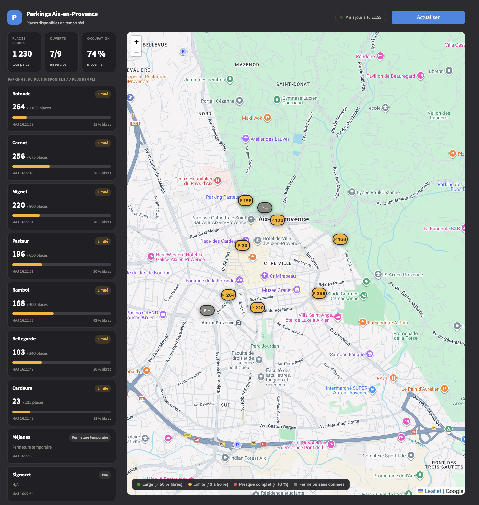
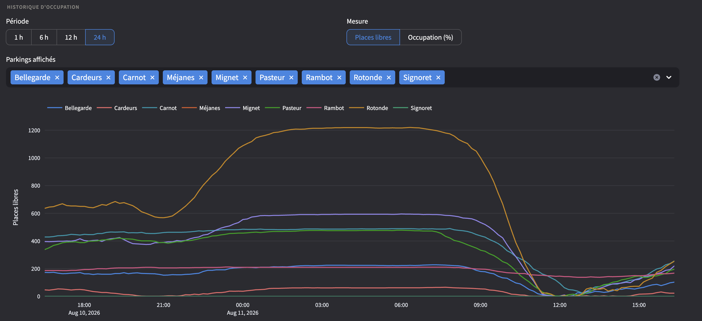

# 🅿️ Dashboard Parkings Aix-en-Provence

Disponibilité en temps réel des 9 parkings publics d'Aix-en-Provence (Bellegarde, Cardeurs, Carnot, Méjanes, Mignet, Pasteur, Rambot, Rotonde, Signoret), avec un historique d'occupation collecté toutes les 10 minutes et archivé sur S3.

**App :** https://parking-aixpress.fr/




## La problématique

À Aix-en-Provence, l'information de disponibilité des parkings publics existe… mais elle est éclatée : chaque parking a sa propre page sur les sites de la Semepa (répartis sur deux domaines), sans vue d'ensemble, sans carte, et sans aucun historique. Pour un automobiliste, impossible de répondre en un coup d'œil aux questions utiles : *où reste-t-il de la place près de ma destination ? est-ce que ça vaut le coup de viser les Cardeurs à cette heure-ci, ou est-il toujours plein le samedi matin ?*

Ce projet centralise cette information dispersée en un point unique :

- **une vue consolidée** des 9 parkings (places disponibles, statut, total) au lieu de 9 pages à consulter une par une ;
- **une carte** pour raisonner par destination plutôt que par nom de parking ;
- **un historique** collecté toutes les 10 minutes, qui transforme une donnée volatile (la page Semepa n'affiche que l'instant présent) en une série temporelle exploitable, visualisation des tendances aujourd'hui, analyse des habitudes et prédiction de disponibilité demain.

Le dashboard affiche les places disponibles parking par parking, une carte interactive avec code couleur selon le taux de remplissage, et un graphique d'historique consultable sur 1 h, 6 h, 12 h ou 24 h (en places libres ou en taux d'occupation).

## Architecture

Le projet sépare strictement deux flux de données qui n'ont pas les mêmes contraintes :

```
                       ┌─> Cache serveur Express (TTL 10 min) ──> Affichage temps réel
Sites Semepa ── Scraping (regex)
                       └─> EventBridge ──> Lambda ──> S3 (AAAA-MM.csv) ──> Graphique historique
                            rate(10 min)                     └──> RDS / analyse / prédiction (à venir)
```

**Le flux temps réel** vit dans le serveur Express de l'application (`web/server/`) : le premier visiteur déclenche un scrape, le résultat est partagé entre tous les utilisateurs pendant 10 minutes (cache mémoire). Si personne ne visite le dashboard, aucune requête n'est envoyée aux sites sources.

**Le flux historique** est totalement découplé de l'application : une fonction AWS Lambda, déclenchée par EventBridge Scheduler toutes les 10 minutes, scrape les 9 parkings et ajoute un relevé au fichier du mois en cours (`history/AAAA-MM.csv`) du bucket S3. L'application n'est qu'un *lecteur* de ces fichiers, elle peut être en veille, planté ou redéployé sans qu'aucune donnée ne soit perdue.

### Pourquoi Lambda plutôt qu'un cron GitHub Actions ?

La première version de la collecte tournait sur un cron GitHub Actions (`*/10 * * * *`). En pratique, GitHub traite les workflows planifiés en basse priorité : sur une journée de test, seuls 2 déclenchements sur ~30 attendus ont eu lieu. Après un correctif partiel (minutes décalées, relevés groupés), la collecte a été migrée vers EventBridge Scheduler + Lambda, ponctuels à la minute. Le workflow GitHub (`scrape-parkings.yml`) est conservé **désactivé** : c'est le plan de secours, réactivable en un clic si la fonction Lambda devait être indisponible. Règle absolue : **un seul écrivain à la fois**, le fichier étant réécrit à chaque relevé (S3 ne fait pas d'append), deux collecteurs concurrents s'écraseraient mutuellement.

### Le format de l'historique

Un fichier CSV par mois (`history/2026-11.csv`, mois en UTC), pensé pour être importé tel quel dans une base relationnelle. Un fichier mensuel pèse ~3 Mo : le réécrire à chaque relevé reste rapide, alors qu'un fichier unique grossissait sans limite et a fini par saturer la Lambda (timeout, 128 Mo). L'historique de juillet à octobre 2026 reste dans l'archive `history/parkings.csv` (lecture seule, plus alimentée) :

| timestamp_utc | date | heure | parking | places_dispo | places_total | statut |
|---|---|---|---|---|---|---|
| 2026-07-03T16:21:14+00:00 | 2026-07-03 | 18:21:14 | Rotonde | 553 | 1800 | ✅ Ouvert |

Le temps est stocké deux fois, et c'est voulu : `timestamp_utc` est la référence canonique (tri, déduplication, fenêtres temporelles, insensible aux changements d'heure), tandis que `date` et `heure` en heure de Paris servent l'analyse métier (« quel taux d'occupation à 11 h ? »). Clé primaire naturelle : `(timestamp_utc, parking)`.

## Gestion des coûts

Volumétrie : ~53 000 relevés/an (6/heure), soit ~475 000 lignes ≈ 40 Mo. Coût AWS total (Lambda + EventBridge + S3) : quelques centimes par an, couvert par le free tier permanent de Lambda.

## Structure du projet

```
Dashboard-parking/
├── web/                            # Application (React + Express), voir web/README.md
│   ├── src/                        # Front Vite + React (pages, composants, hooks)
│   ├── server/                     # API Express : scraping, historique S3, auth Firebase, Airtable
│   ├── shared/                     # Config et logique partagées front/serveur
│   ├── tests/                      # Vitest
│   └── Dockerfile                  # Image de production (non-root, healthcheck)
├── parking_dashboard/              # Package Python de la collecte (Lambda / CLI)
│   ├── config.py                   # Parkings et constantes
│   ├── scraper.py                  # Scraping et parsing des pages Semepa
│   └── storage.py                  # Historique CSV sur S3 (dossier local en dev)
├── lambda/                         # Handler AWS Lambda (collecte de production) + build_zip.sh
├── scripts/scrape_to_s3.py         # Même collecte en CLI (dev local, fallback CI)
├── .github/workflows/              # Collecte de secours (désactivée)
├── tests/                          # Pytest : parsing HTML, stockage
├── notebooks/parking.ipynb         # Exploration initiale du scraping
├── docker-compose.yml              # Déploiement VPS : build depuis GitHub + labels Traefik
└── requirements*.txt               # Dépendances Python de la collecte
```

Deux briques indépendantes : l'**application** (`web/`, Node) et la **collecte** (`parking_dashboard/`, Python, exécutée par la Lambda). Elles ne partagent que le fichier CSV sur S3.

## Installation locale

### Application

```bash
git clone https://github.com/Atomik31/Dashboard-parking.git
cd Dashboard-parking/web
cp .env.example .env     # puis renseigner les valeurs (voir web/README.md)
npm install
npm run dev              # front http://localhost:5173, API http://localhost:3000
npm test
```

L'accès à l'application exige une connexion (Google ou e-mail, via Firebase). Les comptes sont enregistrés dans Airtable (e-mail, méthode, langue, date). Détails, variables d'environnement et mode développement : [web/README.md](web/README.md).

### Collecte (Python)

```bash
pip install -r requirements-dev.txt
python -m scripts.scrape_to_s3 --local   # alimente history/ (ignoré par git)
python -m pytest
```

Les tests couvrent le parsing HTML (nombre de places, « COMPLET », fermeture, page sans données), la construction des statuts et le cycle d'écriture/lecture de l'historique sans dépendre du réseau ni d'AWS.

## Déploiement

### Application — VPS (Docker + Traefik), via GitHub

Tout passe par ce dépôt. `docker-compose.yml` construit l'image depuis GitHub (`build.context` = `…/Dashboard-parking.git#main:web`). Traefik (déjà présent sur le VPS, `network_mode: host`) découvre le conteneur via ses labels et route `https://parking-aixpress.fr` vers son port 3000, avec certificat Let's Encrypt automatique. Le port 3000 n'est lié qu'à `127.0.0.1`.

**Mise à jour = un `git push` sur `main`.** Un cron du VPS (`*/5 * * * *`, `autodeploy.sh`) compare le dernier commit de `main` à celui déployé ; en cas de différence, `deploy.sh` récupère le `docker-compose.yml` du dépôt puis lance `docker compose up -d --build`. Pour revenir en arrière : `git revert` puis push.

Les secrets ne sont jamais dans le dépôt : ils sont dans `/docker/dashboard-parking/.env` sur le VPS (`S3_BUCKET`, `AWS_DEFAULT_REGION`, `AWS_ACCESS_KEY_ID`, `AWS_SECRET_ACCESS_KEY` — utilisateur IAM **lecteur**, `s3:GetObject` —, `AIRTABLE_TOKEN`, `FIREBASE_PROJECT_ID`, `VITE_FIREBASE_API_KEY`).

### Collecte — AWS Lambda + EventBridge

1. **Bucket S3** privé (ex. `dashboard-parking-aix`, région `eu-west-3`), **Versioning activé** : le fichier du mois étant réécrit toutes les 10 minutes, le versioning protège d'un écrasement accidentel. Ajouter une règle de cycle de vie qui purge les versions non courantes après 30 jours.
2. **Rôle IAM** pour la fonction : `AWSLambdaBasicExecutionRole` (logs CloudWatch) + politique inline `s3:GetObject`/`s3:PutObject` limitée à `arn:aws:s3:::BUCKET/history/*`. Aucune clé d'accès dans la fonction : les permissions viennent du rôle d'exécution.
3. **Package** : `./lambda/build_zip.sh` produit `dist/lambda-scraper.zip` (le package métier + `requests`, binaires ciblés `manylinux aarch64` ; boto3 est fourni par le runtime).
4. **Fonction** : Python 3.13, architecture arm64, handler `lambda_function.lambda_handler`, timeout 120 s (le scrape prend ~10 s), **512 Mo** (128 Mo ne suffit pas à lire/réécrire le fichier du mois), variable d'environnement `S3_BUCKET`.
5. **Planification** : EventBridge Scheduler, `rate(10 minutes)`, fenêtre flexible désactivée, cible la fonction.

Suivi dans CloudWatch Logs (`/aws/lambda/scrape-parkings`, rétention 30 jours suffisante).

## Exploiter les données

Le CSV s'importe sans transformation :

```sql
-- PostgreSQL / RDS
COPY parkings FROM '...' CSV HEADER;
```
```python
# pandas
df = pd.read_csv("s3://dashboard-parking-aix/history/2026-11.csv")  # ou history/parkings.csv pour l'archive juil.-oct. 2026
```
```sql
-- DuckDB
SELECT parking, heure, avg(places_dispo)
FROM read_csv_auto('s3://.../history/2026-*.csv')
GROUP BY parking, heure;
```

## Configuration

Parkings (URL, capacité, coordonnées GPS), TTL du cache, seuils d'affichage et palette du graphique (9 couleurs fixes validées pour le contraste et le daltonisme sur fond sombre) : `web/shared/config.js` pour l'application, `parking_dashboard/config.py` pour la collecte. Garder les deux listes de parkings synchronisées.

Le scraping extrait le nombre de places du HTML Semepa par expression régulière :

```
<p class="nbPlaces"><span[^>]*>(\d+)</span>
```

avec une pause de 0,5 s entre chaque parking pour ménager le site source. Les données de parkings sont des compteurs publics. L'application collecte uniquement, pour chaque compte : e-mail, méthode de connexion, langue et date de création (voir la politique de confidentialité dans l'application).

## Roadmap

- [x] Historique des données (graphique temporel)
- [x] Collecte serverless ponctuelle (Lambda + EventBridge)
- [ ] Import RDS et analyse des patterns hebdomadaires
- [ ] Prédiction de disponibilité (ML)
- [x] Application React/Express avec connexion obligatoire (Firebase + Airtable)
- [ ] CI GitHub Actions (lint + tests)
- [ ] Notifications quand un parking se remplit

## Licence & auteur

Projet open source, libre d'utilisation et de modification.
Créé en décembre 2025 par **Julien CHARLIER** les questions et suggestions sont bienvenues via les issues GitHub.
